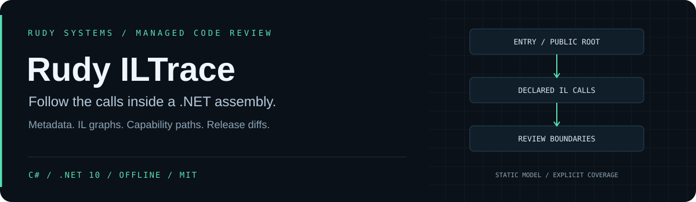

  
  
  
  

<strong>Follow the calls inside a .NET assembly.</strong> Offline IL graphs, explainable capability paths, and release-surface comparison.

<a href="#capabilities">Capabilities</a> · <a href="#install">Install</a> · <a href="#try-it">Examples</a> · <a href="docs/CONTRACT.md">Analysis contract</a> · <a href="docs/RULES.md">Rules</a> · <a href="https://rudy.systems">Rudy Systems</a>

---

**Rudy ILTrace inspects compiled .NET applications as data.** It reads CLR metadata and IL, resolves declared method references, builds a local call graph, and explains shortest paths to catalogued process, network, reflection, dynamic-loading and native-code boundaries. Compare two releases to review changes in their declared public/protected surface, assembly references and capability call sites.

The core, CLI, graph algorithms and regression runner are written in **C# / .NET 10**, using the runtime's metadata APIs without third-party packages. Target assemblies are never loaded into the CLR or invoked. Dependencies are inventoried but are not opened or resolved.

**v0.1.0 developer preview.** A path describes declarations in a bounded static model. It does not prove runtime reachability, data flow, maliciousness, exploitability or full API compatibility. Virtual dispatch, callbacks, delegates, reflection, async continuations and implicit type initialization require further review.

~~~text
managed PE snapshot
        │
metadata + signature decoder
        │
bounded IL decoder ── instruction/branch checks
        │
declared call graph ── recursive groups
        │
        ├── scan: capabilities + native boundaries
        ├── trace: shortest local-call paths
        └── diff: release surface + capability drift
                    │
            text / JSON / SARIF / DOT
~~~

## Capabilities

| Area | Implemented behavior |
| --- | --- |
| Metadata inventory | Assembly identity, SHA-256 snapshot digest, method signatures and visibility, references, native imports, and manifest resource names |
| IL decoding | One- and two-byte opcodes, fixed and switch operands, call tokens, instruction-boundary branch checks, and exception-region bounds |
| Call resolution | Local MethodDef targets, generic MethodSpec references, external MemberRef identities, declared virtual targets, and explicit unresolved/indirect coverage |
| Graph analysis | Deterministic multi-root breadth-first paths and iterative strongly connected components for recursion |
| Capability review | Process launch, HTTP/socket clients, file writes, reflection invocation, assembly/code loading, formatter deserialization, native imports and indirect calls |
| Release comparison | Added/removed declared public/protected types, methods and fields; assembly reference changes; capability additions/removals independent of IL offsets |
| Integration | Text and versioned JSON, SARIF 2.1.0 with method/IL evidence and trace code flows, Graphviz DOT, and explicit CI gates |
| Resource control | File/table/signature/IL/instruction/call/text budgets; explicit traversal cutoffs; new-file-only report writes |

See the [rule catalogue](docs/RULES.md) and [analysis contract](docs/CONTRACT.md) before integrating a gate.

## Install

Download the portable ZIP from [Releases](https://github.com/r4venrudy/rudy-iltrace/releases), verify its SHA-256 against SHA256SUMS, and extract it. The portable distribution requires the **.NET 10 runtime** on Windows, Linux or macOS:

~~~sh
dotnet Rudy.ILTrace.Cli.dll --version
dotnet Rudy.ILTrace.Cli.dll scan samples/Probe.dll
dotnet Rudy.ILTrace.Cli.dll trace samples/Probe.dll --category process
~~~

The same release provides an installable **Rudy.ILTrace.Tool.0.1.0.nupkg**. It is distributed through GitHub releases; publication to nuget.org is not claimed.

To build from source, install the **.NET 10 SDK**:

~~~sh
git clone https://github.com/r4venrudy/rudy-iltrace.git
cd rudy-iltrace
dotnet build Rudy.ILTrace.slnx -c Release
dotnet run --project tests/Rudy.ILTrace.Tests -c Release --no-build -- .
dotnet pack src/Rudy.ILTrace.Cli -c Release --no-build -o artifacts
dotnet tool install Rudy.ILTrace.Tool --version 0.1.0 --tool-path .tools --add-source artifacts --configfile NuGet.Config
~~~

NuGet.Config clears external sources; the solution has no package dependencies. The installed command is .tools/rudy-iltrace on Unix-like systems and .tools/rudy-iltrace.exe on Windows. The examples below use rudy-iltrace as shorthand.

## Try it

The source tree builds synthetic fixtures under tests/Fixtures. The portable ZIP includes their compiled counterparts under samples. They are metadata inspection inputs; the example workflow does not execute their code.

~~~sh
# Inventory a supplied application.
rudy-iltrace scan app.dll --format json --output new-report.json

# Explain paths from its managed entry point to process APIs.
rudy-iltrace trace app.dll --roots entry --category process --format text

# Library review: use declared public/protected methods as roots.
rudy-iltrace trace library.dll --roots public --format sarif --output library.sarif

# Review an assembly's explicit call graph.
rudy-iltrace scan app.dll --format dot --output calls.dot

# Compare two releases with the same declared assembly name.
rudy-iltrace diff old/app.dll new/app.dll --fail-on api-removed
~~~

After a source build, this command demonstrates the bundled multi-hop process path:

~~~sh
dotnet run --project src/Rudy.ILTrace.Cli -c Release --no-build -- trace tests/Fixtures/Probe/bin/Release/net10.0/Probe.dll --category process
~~~

It identifies the declared chain **Main → Stage → Launch → Process.Start**, with each call's IL offset. The fixture deliberately contains a conditional branch; ILTrace does not claim that the branch is taken.

See [examples/README.md](examples/README.md) for the release-diff example and supported options.

## Gates and output

| Command | Gate options |
| --- | --- |
| scan / trace | none, note, warning |
| diff | none, api-removed, capability-added, any |

Use --fail-on to choose a gate; the default is none. Exit codes are **0** completed/pass, **1** a selected gate matched, **2** invalid/unsupported input or a trace cutoff, and **3** output failure. A trace that reaches its depth or path limit still writes its explicit partial report and returns 2.

Reports written with --output must use a **new path**. Existing files, including input assemblies and earlier reports, are preserved. SARIF uses logical method locations and IL-offset properties; no source-line locations are invented.

## Scope

ILTrace supports managed PE assemblies with CLR metadata and IL bodies. It does not analyze NativeAOT programs, standalone netmodules, native method bodies, referenced dependency bodies, unpacked payloads, or dynamic runtime-generated code. It does not perform stack verification, branch-feasibility analysis, deobfuscation, taint analysis, or execution.

Callvirt edges name declared targets; override dispatch is unresolved. Function references are retained as coverage observations and do not become execution edges. Generic members on constructed local types may remain unresolved. Capability rules match metadata names, which can be spoofed and do not authenticate an API's publisher. Missing paths must not be treated as proof of absence.

The surface diff covers declared types, methods and fields plus accessor methods. Generic constraints, custom attributes, constants/default values, type layout and other compatibility conditions are outside the comparison contract.

## Project

[Design and limits](docs/CONTRACT.md) · [Rules](docs/RULES.md) · [Contributing](CONTRIBUTING.md) · [Security](SECURITY.md) · [MIT license](LICENSE)

RUDY SYSTEMS · Local analysis. Clear evidence. · <a href="https://rudy.systems">rudy.systems</a>

